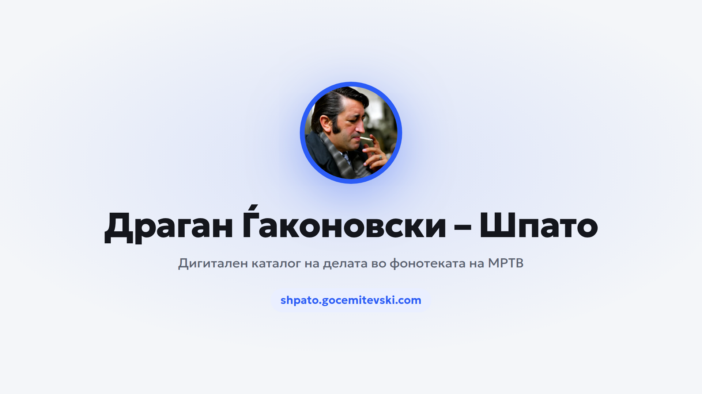

# ДЕЛ ОД ТВОРЕШТВОТО НА ДРАГАН ЃАКОНОВСКИ – ШПАТО ВО ФОНОТЕКАТА НА МАКЕДОНСКА РАДИО ТЕЛЕВИЗИЈА (МРТВ)

Податоците се достапни како неколку датотеки во формат CSV (Comma-Separated Values). Преземени се од монографијата за Драган Ѓаконовски – Шпато, „Драган Ѓаконовски – Шпато: Музичка легенда“, од Ванчо Димитров.

## ДИГИТАЛЕН КАТАЛОГ

Во складиштето има и мала веб-апликација (без никакви надворешни библиотеки)
преку која податоците можат да се пребаруваат, филтрираат и разгледуваат.

Можности:

- Пребарување по наслов, изведувач и автор, со поддршка за кирилица и латиница
  (на пр. „Impulsi“ го наоѓа „Импулси“).
- Филтри по категорија, изведувач, автор, збирка (префикс на сигнатура) и времетраење.
- Пуштање на делото: ако постои снимка на YouTube, делото има копче за пуштање
  што отвора мал плеер долу десно и продолжува да свири додека пребарувате,
  филтрирате или читате детали. Изборот „Само со снимка“ ги прикажува само
  делата што можат да се слушнат.
- Подредување по колона и извоз на резултатите во CSV или JSON.
- Статистика: вкупен број и траење, најзастапени изведувачи и автори,
  распределба по категорија, збирка и времетраење.
- Забелешки: секоја недоследност во изворните датотеки и нејзината нормализација.
- „За Шпато“: кратка биографија со основните податоци и изворите од кои се
  преземени (монографијата, Grove Music Online и Годишникот на ФМУ).
- Двојазичен интерфејс (македонски / англиски).
- Светла и темна тема; изборот се памети, а на почетокот се следи системската поставка.

Структура:

    index.html                 - страницата на апликацијата
    assets/styles.css          - стилови (извор)
    assets/*.min.css|.min.js   - генерирани стилови и скрипти што ги вчитува страницата
    assets/fonts/*.woff2       - фонтот Geologica (само-вдомен, OFL 1.1)
    assets/images/             - корица, логоа и фотографијата во „За Шпато“
    assets/i18n.js             - текстови на македонски и англиски
    assets/app.js              - логика (пребарување, филтри, статистика, извоз)
    tools/build.py             - генерирање на нормализираните податоци
    tools/minify.py            - минификатор што го повикува build.py
    tools/youtube-search.py    - помош при барање на врски до YouTube (не е дел од изградбата)
    tools/cover.html           - шаблон за корицата за споделување (1920×1080)
    tools/favicon.html         - шаблон за favicon-сликите
    data/catalog.json|.js      - нормализиран каталог (генериран)
    data/notes.json|.js        - забелешки за податоците (генерирани)
    sources/*.csv              - изворните датотеки од монографијата (влез; изградбата не ги менува)
    sources/youtube.csv        - врски до YouTube (влез; проверени и автоматски најдени)

Како да се отвори апликацијата:
  Отворете `index.html` директно во прелистувач, или покренете локален сервер:

      python3 -m http.server

  по што отворете http://localhost:8000/

Како да се регенерираат податоците (по промена на CSV-датотеките):

      python3 tools/build.py

  Скриптата ги чита изворните CSV-датотеки, ги нормализира полињата
  (времетраење, сигнатури, дупликати) и ги запишува `data/catalog.*` и
  `data/notes.*`. Изворните CSV-датотеки остануваат непроменети. Истата
  скрипта ја внесува и секоја врска од `sources/youtube.csv` во делото.

## ВРСКИ ДО YOUTUBE

Врските се чуваат во `sources/youtube.csv`, со колони
`id,title,video,found,lengthSec`. `tools/build.py` ја внесува секоја врска во
делото како поле `video`; насловот е само проверка, па ако не се совпаѓа со
записот, изградбата предупредува (исто како и за непознат `id`). Во `video` може
да се стави и целата адреса од YouTube — скриптата сама го извлекува
идентификаторот. `lengthSec` е времетраењето на самата снимка, во секунди.

`found` кажува од каде е врската: празно или `human` за врска што некој ја
проверил, `search` за врска што ја предложила `tools/youtube-search.py`, а
никој не ја потврдил. За ваквите врски, ако времетраењето на снимката се
разликува од она во каталогот за повеќе од 5 секунди, изградбата го означува
делото со забелешка `video-approximate`: во деталите стои дека снимката е
најдена автоматски и за колку се разликува, а во табот „Забелешки“ има ред со
двете времетраења.

Дело без врска нема копче за пуштање; во деталите му се нуди пребарување на
YouTube. Отворена директно од диск (`file://`), страницата нема потекло и
YouTube не дозволува вграден плеер, па таму копчето за пуштање го отвора
видеото на YouTube во ново јазиче; вградениот плеер работи преку сервер
(http/https). За да најдете врски:

      python3 tools/youtube-search.py --selftest    # како се држи правилото
      python3 tools/youtube-search.py --limit 50    # преглед на предлозите
      python3 tools/youtube-search.py --apply --limit 400
      python3 tools/youtube-search.py --verify      # дали веќе запишаните врски сè уште важат
      python3 tools/youtube-search.py --verify --drop   # отстрани ги тие што не важат

Целта на врската е читателот да може да ја слушне композицијата, а не да се
потврди дека е истата снимка од фонотеката. Затоа времетраењето не одлучува:
„Blagoja Ceslarov - Aranhuez“ е 90 секунди подолго од времето во каталогот, а
сепак е вистинската композиција. Но снимка не може да биде произволно подолга
или пократка: под половина од времетраењето е исечок, а над 120 секунди повеќе
е подкаст или цел албум, не издание на делото. Скриптата прифаќа кандидат кога
неговиот наслов го содржи насловот на делото и нешто го поврзува со изведувачот
или аранжерот: збор од името на изведувачот во насловот на видеото, два такви
збора на страницата, канал од кој веќе дошла рачно потврдена врска, или потпис
на аранжерот. Она што не се олеснува е насловот: мора да се совпадне целиот,
збор по збор, со толеранција само за различен завршеток и за различно предавање
на буквите („Молчи“ и „Molci“ се истиот наслов). Половина од зборовите не е
доволно: „Сонце во твоите руси коси“ се совпаѓа со „Да потонам во твоите коси“
токму на зборовите што не кажуваат која е песната. Еден краток збор може да
отсуствува („Igraj kalipso“ за „Играј и пеј калипсо“), но број не може, ниту
одрекување: „Верувај ми“ не е „Не ми верувај“. Ако во насловот на делото
има заграда што го именува делото вторпат („Осаменост (Молчи една долина)“),
доволно е едното од двете имиња; заграда што само кажува како е направено
изданието („(џез верзија)“, „(live)“) не се брои. Така не се помеша „Без тебе“
со српското „Bez tebe“ или со руското „Чувства“. Изведувачот мора да е именуван
целосно кога насловот е само еден збор, за да не се најде песната „Илузија“ во
подкаст со „iluzija“ во насловот.
Делото прво се бара со насловот и изведувачот, а ако така не се најде прифатлив
кандидат, пребарувањето се проширува (`--exhaustive` ги пробува сите варијанти).
Секое проширување го покажува и тоа кое барање ги дало резултатите, и зошто
кандидатот е прифатен.

## ЗАБЕЛЕШКИ ЗА ПОДАТОЦИТЕ

Изворните датотеки содржат недоследности кои скриптата ги нормализира, а секоја
интервенција се евидентира во `data/notes.json` (видлива и во апликацијата,
под „Забелешки“). Меѓу нив:

- Датотеката со аранжмани на теми од други автори има погрешно заглавје
  (не ја содржи колоната „автор“, иако редовите ја имаат).
- Времетраења без децимална точка („405“ → 4:05) и двозначни записи („3.7“ → 3:07).
- Сигнатури без префикс, со двоен префикс, со вишок коса црта, со латинична
  буква или без цртичка (на пр. „3192/4“, „З-З-7683/2“, „Z-3531/3“).
- Непознат автор означен со „+++“.
- Дупликати и можни дупликати (ист наслов и изведувач).
- Празни полиња (изведувач, времетраење, сигнатура).
- Растојание по иницијал и околу коса црта („A.Vivaldi“ → „A. Vivaldi“,
  „Љупка Апостолова/Т.Маниќ“ → „Љупка Апостолова / Т. Маниќ“).
- Латинична буква што личи на кирилична, внатре во кириличен збор
  („oктомври“ → „октомври“, „ТO на РТС“ → „ТО на РТС“).
- Кратенката „Т.О.“ → „ТО“ (истата институција се пишува на два начина).
- Печатни грешки („Имулси“ → „Импулси“, „Крствески“ → „Крстевски“,
  „Томновска“ → „Томовска“, „Петкповска“ → „Петковска“).
- Исто лице запишано и како иницијал и како полно име
  („Г.Копров“ → „Григор Копров“, „А.Џамбазов“ → „Александар Џамбазов“).
- Изведувачот е одделен од улогата/инструментот или придружниот оркестар
  („Кирил Рибарски, тромбон“ → изведувач „Кирил Рибарски“, улога „тромбон“;
  „Нина Спирова со ЗА“ → „Нина Спирова“). Улогата се гледа во деталите на делото.
- Обединети варијанти на исто име или ансамбл („З. Јовановиќ“ → „Зоран
  Јовановиќ“, „Н. Кимов/Н. Кимовски/Н. Комовски“ → „Никола Комовски“,
  „Паркс“ → „C. Parks“, „Забавен анс./орк. на РС“ → „Забавен оркестар на РС“).
- Нормализирана триточка („...“ → „…“).

Вкупен број на записи: 433 (вокални 74, инструментални 55, аранжмани на теми 43,
аранжмани на вокални творби 261). Изворите содржат 434 реда, но еден е дупликат
и е отстранет од каталогот (видливо под „Забелешки“).

## ЛИЦЕНЦИ

- Фонтот Geologica (assets/fonts/*.woff2) е само-вдомен од Google Fonts и е
  достапен под SIL Open Font License 1.1: https://fonts.google.com/specimen/Geologica
- Фотографијата на Шпато диригира во табот „За Шпато“
  (assets/images/Dragan-Gjakonovski-Shpato-About.jpg) е од Радио Слободна
  Европа (RFE/RL) и се користи со наведен извор:
  https://www.slobodnaevropa.mk/a/3537129.html
